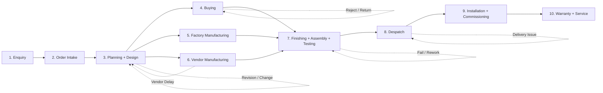
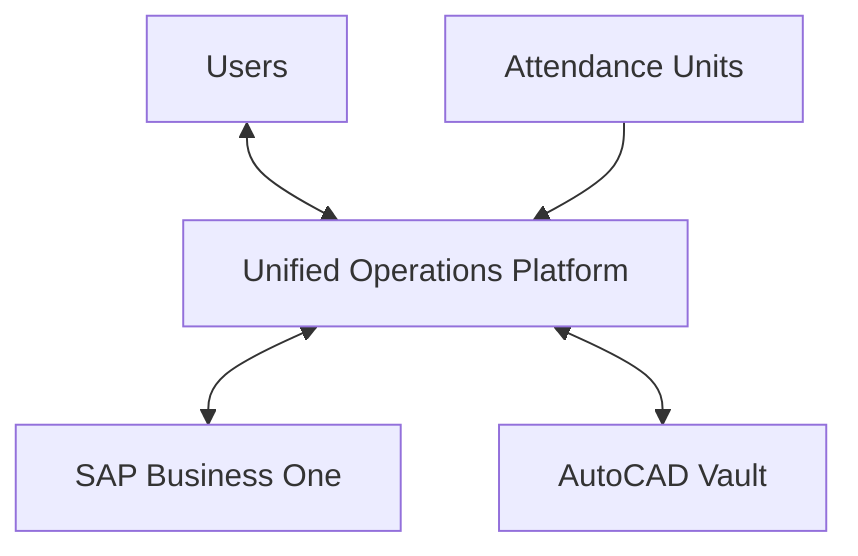
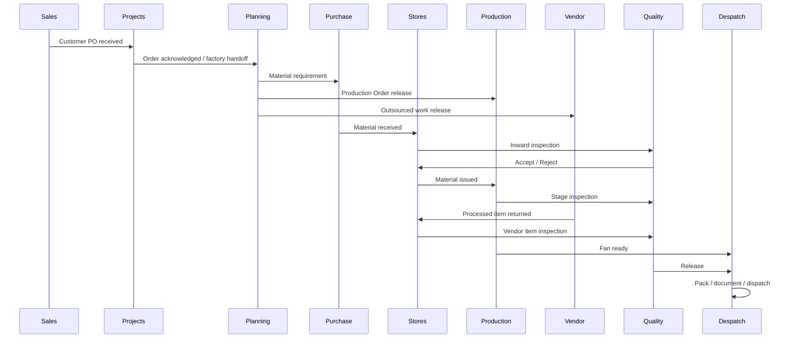
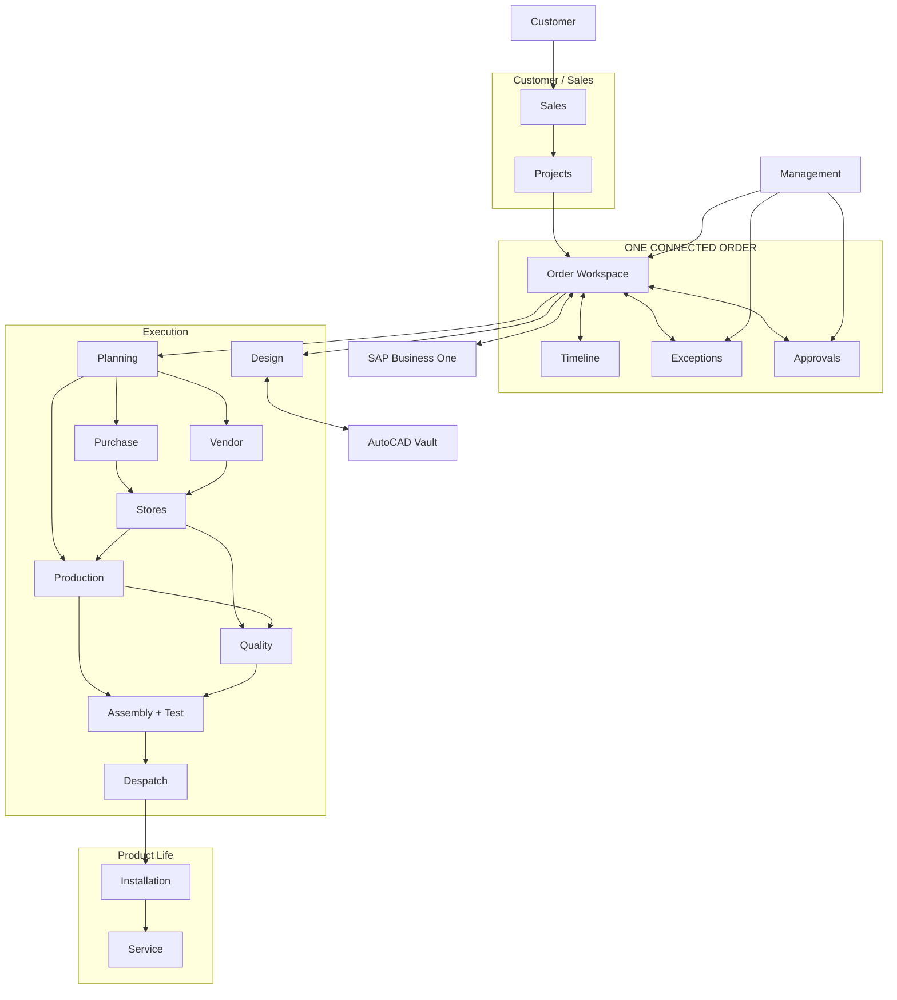

# Nadi Airtechnics — Unified Operations Platform
## Product Requirements Document (PRD)

**Document status:** Draft for UX / Product / Engineering alignment  
**Source basis:** *Nadi Airtechnics Unified Operations Platform — Business Process & System Flow Document, Revision 3, August 2026*  
**Product principle:** **ONE ORDER → ONE CONNECTED HISTORY → EVERY DEPARTMENT UPDATES IT → EVERYONE SEES THE CURRENT STATUS**

---

# 1. Executive Summary

Nadi Airtechnics needs a unified operations platform that makes the company’s existing order process easier to run without creating another layer of work.

The product should not ask people to “manage the system.” It should help them **do the work they already do**, while automatically connecting the resulting information to the same order.

Today, the business relies on several systems plus a shared “Pending Order” Excel workbook. Projects and Planning maintain the workbook, status is often communicated verbally, and information is re-entered across systems. This creates a single-editor bottleneck, weak live visibility, duplicate effort, and manual tracking of production and delays.

The proposed product replaces the operational role of that Excel workbook with a role-aware workflow layer around SAP Business One and AutoCAD Vault. SAP Business One remains the system of record for financial and ERP transactions. AutoCAD Vault remains the controlled source for drawings and revisions. The platform becomes the place where people **see work, update progress, handle exceptions, approve decisions, and understand the current state of every order**.

The product must simplify the existing process, not digitize every existing step literally.

## The product promise

> **When a person opens the platform, they should immediately know what needs their attention, what they need to do next, and what will happen after they do it.**

---

# 2. First-Principles Product Model

The entire product is built around five questions.

| Question | Product answer |
|---|---|
| What is this work about? | One **Order** |
| Where is it right now? | One **Current Status** |
| What has happened so far? | One **Connected History** |
| What needs to happen next? | One **Next Action / Owner** |
| What is preventing progress? | One **Exception** with an owner and due date |

The platform should perform the maximum amount of coordination automatically and ask users for the minimum amount of information required.

## Non-negotiable UX rules

1. **Show the current state first.** Users should never need to search through records to find whether an order is ready, blocked, late, or waiting.
2. **Use the language of the department.** “Start Job”, “Receive Material”, “Pass Inspection”, “Send to Vendor”, and “Ready to Dispatch” are better than technical workflow terms.
3. **Recognition over recall.** Show the order, drawing revision, quantity, required date, and next action in context. Do not make people remember numbers or navigate between screens unnecessarily.
4. **One action, one obvious result.** Every important action must immediately confirm what changed.
5. **Prevent errors before submission.** Do not allow incomplete BOM release, duplicate submissions, invalid status transitions, or dispatch with required documents missing.
6. **Exceptions are visible work, not hidden alerts.** Every exception has a reason, owner, due date, current impact, and next action.
7. **No silent handoffs.** When one role finishes, the next role receives a clear task.
8. **Do not make users duplicate information.** Carry forward customer, order, material, quantity, drawing revision, dates, and prior decisions automatically.
9. **Role-based simplicity.** A shop-floor operator should see a job, not financial dashboards. A manager should see the business, not machine-level controls.
10. **Save and recover automatically.** A disconnected device must preserve work and synchronize later.
11. **Use color as support, never as the only status cue.** Every state must have a text label and a recognizable visual treatment.
12. **Prefer one powerful screen over many administrative screens** when the user’s job can be completed safely in one place.

These principles align with established interaction-design guidance around visibility of system status, real-world language, user control, consistency, error prevention, recognition, efficiency, minimalist design, error recovery, and contextual help.

---

# 3. Problem Statement

## Current problems

### 3.1 One Excel file acts as the operational glue

The “Pending Order” workbook is currently maintained jointly by Projects and Planning. Because only one person can effectively edit it at a time, updates can be delayed or communicated verbally. The file has also previously suffered data loss.

### 3.2 No single live order view

A person may need to contact multiple departments to answer a basic question:

> “Where is this order?”

### 3.3 Production visibility is manual

Planning maintains status manually. Manufacturing progress is not consistently connected to the Job Number and individual Manufacturing Orders.

### 3.4 Vendor work is difficult to see

Material can leave Nadi and remain with a vendor with limited visibility until it returns.

### 3.5 Exceptions are discovered too late

Shortages, vendor delays, revisions, quality failures, and delivery risks need to be surfaced while there is still time to act.

### 3.6 Shop-floor adoption is fragile

The shop-floor experience must be extremely simple. The source process specifically calls for a practical one- or two-action start/stop pattern and simple shared-device usage.

---

# 4. Product Goals

## Primary goals

- Replace the operational role of the Pending Order Excel workbook.
- Give every order a single connected history.
- Make the current order status visible to every authorized role.
- Reduce duplicate data entry.
- Make the next action obvious.
- Make exceptions visible early.
- Connect Job Numbers to Manufacturing Orders.
- Support simple production start/stop and completion tracking.
- Preserve SAP Business One as the ERP/system of record.
- Preserve AutoCAD Vault as the controlled drawing repository.
- Give management an actionable exception-first view.
- Build the architecture so future phases can extend into vendor portals, customer portals, installation, warranty, service, capacity planning, and MRP.

## Success means

A user should no longer need the Pending Order Excel sheet to answer:

> “What is happening with Order X?”

The platform should answer it from the connected order record.

---

# 5. Non-Goals

The first release should **not**:

- Replace SAP Business One.
- Replace AutoCAD Vault.
- Rebuild the complete CRM in Phase 1.
- Move full engineering drawing authoring into the platform in Phase 1.
- Introduce complex MRP or capacity planning in Phase 1.
- Force every employee to use a desktop application.
- Create separate master data versions in the platform.
- Require users to update both the platform and Excel.
- Recreate every historical Excel field as a mandatory field.
- Make every user see every module.
- Turn every event into a notification.

---

# 6. Scope Strategy

## Phase 1 — Operational MVP

### Core journey

**Order Entry → Planning → Manufacturing → Closure / Despatch**

### Included

- Order record and order identity
- Pending Order replacement
- Job Number → Manufacturing Order visibility
- Planning status
- Need Date
- Promise Date
- Revised Delivery Date
- Manufacturing plan
- Ready / Backlog / Hold
- Production start/stop
- Completion
- Rework
- Scrap
- Downtime
- Shortage visibility
- Delay list
- Basic vendor/bought-out visibility
- Quality status relevant to Phase 1
- Despatch closure
- Role-based attention feed
- Order-level timeline
- Management order and production visibility
- SAP Business One integration required for Phase 1

## Phase 2 — Target end state

- Enquiry and quotation in platform
- Full design/BOM workflow
- Vendor work orders and vendor portal
- Advanced purchase workflow
- Capacity planning
- MRP-related capabilities
- Installation and commissioning
- Customer portal
- Warranty and service
- Preventive maintenance
- Executive dashboards including broader finance metrics
- Deeper production analytics

---

# 7. Core Information Architecture

The product should have a **role-aware shell** rather than one giant ERP navigation.

## Universal structure

```text
TODAY
  ↓
MY WORK / ORDERS
  ↓
ORDER
  ├── Overview
  ├── Timeline
  ├── Planning
  ├── Material
  ├── Production
  ├── Vendors
  ├── Quality
  ├── Despatch
  ├── Documents
  ├── Costs
  └── Exceptions
```

## Suggested primary navigation

```text
Today
Orders
Work
Planning
Material
Quality
Vendors
Despatch
Service
Reports
Admin
```

Only relevant items appear for each role.

### Example

An operator may see:

```text
Today
My Jobs
```

A Planning user may see:

```text
Today
Orders
Planning
Material
Vendors
Reports
```

A management user may see:

```text
Today
Orders
Reports
Approvals
```

---

# 8. The Core Object: ONE ORDER

## Order is the center of the product

The system should not make users jump between separate “Sales Order”, “Production Order”, “Vendor Order”, “Quality Record”, and “Despatch Record” screens to understand one customer job.

Those are related records behind **one Order Workspace**.

## Order identity

An order should be identifiable using:

- Customer
- OA / Job Number
- SAP Sales Order
- Customer PO
- Fan Model
- Quantity
- Need Date
- Promise Date
- Revised Delivery Date
- Current Stage
- Current Status
- Current Owner
- Delivery Risk

## Order header

```text
--------------------------------------------------------------
ORDER: OA-001234                         AT RISK
Customer: ABC Industries                 Promise: 20 Sep
Fan: Model XYZ                           Revised: 25 Sep

CURRENT STAGE
Vendor Fabrication  ───────────────  75%

NEXT ACTION
Purchase → chase vendor by 10 Sep

DELIVERY
5 days at risk
--------------------------------------------------------------
```

The user should see the most important answer before the details.

---

# 9. ONE CONNECTED HISTORY

Every meaningful event becomes an entry in the order timeline.

## Timeline event structure

```text
[Date / Time]
Actor
Action
Reason (when required)
Evidence
Result
Next Owner
```

### Example

```text
10 Sep, 10:42 AM
Planning

Vendor milestone missed

Reason:
Vendor reported welding delay

Impact:
Assembly start moves by 2 days

Action:
Re-sequenced assembly

Next:
Purchase to follow up with vendor
```

## Timeline rules

- The timeline is append-only for audit.
- Corrections create a new correction event; history is never silently overwritten.
- Photos, documents, measurements, approvals and comments can be attached to the relevant event.
- Every handoff generates a timeline event.
- Every exception generates a timeline event.
- Every status change records who changed it and why when required.

---

# 10. MASTER ORDER LIFECYCLE



### Important scope note

Phase 1 primarily delivers:

```text
Order Intake
   ↓
Planning
   ↓
Factory Manufacturing
   ↓
Visible Vendor/Bought-out Status
   ↓
Finishing / Assembly / Testing
   ↓
Despatch Closure
```

Phase 2 extends the same order identity into:

```text
Installation
   ↓
Commissioning
   ↓
Installed Base
   ↓
Warranty
   ↓
Service
```

---

# 11. Roles

## Role model

| Role | Primary job in the platform | Primary success question |
|---|---|---|
| Sales | Enquiries, quotations, customer communication | What did we promise the customer? |
| Projects | Own order commercially and communicate delivery | Is the order accepted, controlled and commercially healthy? |
| Planning | Convert orders into an executable plan | Can we deliver on the promised date? |
| Design | Fan selection, drawings, BOM | Is the design complete and correct? |
| Purchase | Buy material and manage supplier performance | Will required material arrive on time? |
| Stores | Receive, issue, locate and reconcile material | Do we have the right material, where is it? |
| Production Supervisor | Manage factory jobs and progress | What is running, stopped, delayed or complete? |
| Operator | Start/stop job, confirm output, flag issue | What am I doing right now? |
| Vendor | Execute outsourced work and report progress | What must I complete and by when? |
| Quality | Inspect, pass/reject, manage non-conformance | Is this safe/correct to move forward? |
| Despatch | Pack, document, ship, capture delivery | Can this unit leave now? |
| Service Engineer | Install, commission and service units | What do I need to do at this site? |
| Service Desk | Own installed base, tickets and scheduling | What service work needs attention? |
| Management | Monitor exceptions, delivery, margin and performance | Where is attention needed today? |
| System Admin | Users, roles, integrations, configuration | Is the platform running correctly? |
| Customer | View own orders, units, documents and service | Where is my order/unit and what happens next? |

---

# 12. ROLE UX RULE

Every role receives a **personal work surface**.

Never start with a full database.

Start with:

> **What needs my attention today?**

Then let the user drill into the order.

---

# 13. MODULE 01 — TODAY / ATTENTION CENTER

## Purpose

Replace the habit of checking spreadsheets, emails and verbal updates to find work.

## Primary screen

### Today

```text
TODAY

Needs attention
─────────────────────────
3 approvals
5 delivery risks
4 material shortages
2 vendor delays
1 blocked BOM
3 quality issues

My work
─────────────────────────
Due today: 8
Overdue: 2
Waiting for me: 4
```

## Actions

- Open exception
- Approve
- Assign
- Reassign
- Resolve
- View affected order
- Open related task
- Snooze only where business rules allow
- Filter by urgency / department / owner

## Statuses

- New
- Due today
- Overdue
- At Risk
- Blocked
- Awaiting Action
- Resolved

## UX rule

Do not make users interpret charts to find urgent work.

---

# 14. MODULE 02 — ORDERS

## Purpose

One searchable list of all orders.

## Screens

### 14.1 Orders List

Columns:

- OA / Job Number
- Customer
- Model
- Qty
- Promise Date
- Current Stage
- Current Status
- Delivery Risk
- Current Owner
- Last Updated

### 14.2 Order Workspace

Sections:

```text
Overview
Timeline
Stage Progress
Planning
Material
Production
Vendor
Quality
Despatch
Documents
Cost
Exceptions
```

### 14.3 Order Search

Search by:

- OA No.
- SAP No.
- Customer PO
- Customer
- Model
- Serial number
- Vendor
- Status

## Actions

- Open
- Add / update relevant data
- Approve
- Put on hold
- Resume
- Change owner
- Raise exception
- Add note
- View history
- View related SAP transaction

---

# 15. MODULE 03 — PLANNING

## Purpose

Turn an order into an executable delivery plan.

## Primary screen

### Planning Board

```text
ORDER       PROMISE     CURRENT       RISK
OA-001      20 Sep      Production    LOW
OA-002      18 Sep      Vendor 75%    HIGH
OA-003      25 Sep      Material      BLOCKED
OA-004      30 Sep      Ready         LOW
```

## Screens

- Planning Queue
- Order Plan
- Material Shortage View
- Vendor Progress View
- Delivery Risk View
- Manufacturing Plan
- Delay List

## Actions

- Confirm / revise delivery date
- Release work
- Release long-lead item
- Decide make / buy
- Re-sequence work
- Put work on hold
- Restart
- Assign vendor
- View shortage impact
- View revision impact

## Statuses

- Not Planned
- Planned
- Ready to Release
- Released
- At Risk
- On Hold
- Blocked
- Complete

## Handoff

Planning → Production:

> “Production Order released + job is ready”

Planning → Purchase:

> “Material requirement released”

Planning → Vendor:

> “Vendor work order ready”

---

# 16. MODULE 04 — DESIGN / ENGINEERING

## Phase 1

Design remains primarily in AutoCAD Vault. The platform should consume the released state and relevant metadata rather than duplicate engineering authoring.

## Phase 2 screens

- Design Queue
- Drawing Workspace
- Revision Review
- BOM Builder
- BOM Validation
- Release Checklist

## Actions

- Select model
- Create estimating BOM
- Create / update BOM
- Validate material codes
- Submit for approval
- Release BOM
- Raise revision
- View impact of revision

## Critical UX rule

Never ask the user to re-enter information already available from the order.

## Release gate

BOM cannot be released if required fields are missing.

The system must explain exactly what is missing.

Example:

```text
Cannot release BOM

3 lines need attention:
• Line 12 — material code missing
• Line 18 — quantity missing
• Line 24 — unit missing

[Fix missing items]
```

---

# 17. MODULE 05 — PURCHASE

## Phase 1

Provide visibility of bought-out status and shortages.

## Phase 2

Full requisition → quotation → purchase order workflow.

## Screens

- Purchase Queue
- Requisitions
- Supplier Quotes
- Purchase Orders
- Supplier Follow-up
- Supplier Scorecard
- Material Risk

## Actions

- Compare supplier quotes
- Select supplier
- Approve
- Release PO
- Chase overdue PO
- Record supplier response
- Initiate return/replacement
- Escalate price variance
- Mark source risk

## Statuses

- Requirement
- Quote Pending
- Quote Received
- Under Review
- Approved
- Ordered
- Partially Received
- Awaiting Inspection
- Accepted
- Rejected
- Returned
- Closed

---

# 18. MODULE 06 — STORES

## Screens

- Receiving Queue
- Stock / Location
- Material Issue
- Vendor Issue
- Vendor Return
- Reconciliation
- Spares

## Actions

- Receive
- Scan
- Issue
- Return
- Assign location
- Issue to Production Order
- Issue to Vendor on challan
- Reconcile quantity
- Flag short/excess

## Key rule

A Stores user should not manually type data that can be scanned.

## Example

```text
SCAN
↓
System finds PO / Job
↓
Shows expected quantity
↓
User confirms received quantity
↓
Inspection required? → Yes
↓
Quality task created
```

---

# 19. MODULE 07 — PRODUCTION

## Primary design principle

**Production must be faster than paper.**

If a user needs more actions than the physical task requires, the UX is wrong.

## Production Supervisor screens

- My Section
- Jobs Ready
- Jobs Running
- Jobs Blocked
- Completed
- Downtime / Rework

## Operator screen

```text
JOB: OA-001234
Operation: Shaft Machining

[ START JOB ]

Current:
Not Started
```

After starting:

```text
JOB: OA-001234
Operation: Shaft Machining

Started 10:42 AM

[ STOP JOB ]
[ REPORT PROBLEM ]
```

After stopping:

```text
What happened?

[ Completed ]
[ Quantity Done ]
[ Rework ]
[ Scrap ]
[ Downtime ]
```

Use the smallest possible form.

## Shared-device flow

```text
Scan / Select Job
      ↓
Confirm User
      ↓
START
      ↓
WORK
      ↓
STOP
      ↓
Confirm Result
      ↓
Next Job
```

## Statuses

- Ready
- In Progress
- Paused
- Blocked
- Rework
- Complete
- Cancelled

## Required records

- Start time
- Stop time
- Operator
- Operation
- Quantity
- Rework
- Scrap
- Downtime reason, where applicable

---

# 20. MODULE 08 — VENDOR

## Phase 1

Vendor-related fields remain visible as status information.

## Phase 2

Vendor portal.

## Vendor portal screens

- Work Orders
- Current Drawing
- Progress
- Material Received
- Queries
- Dispatch
- History

## Actions

- Accept work order
- Confirm completion date
- View current drawing revision
- Confirm material received
- Update milestone
- Raise query
- Mark ready
- Create dispatch note

## Critical design requirement

The vendor must always see the **current controlled drawing revision**.

Superseded drawings must be visually and behaviorally separated from the current version.

---

# 21. MODULE 09 — QUALITY

## Screens

- Inspection Queue
- Stage Gate
- Incoming Inspection
- Final Inspection
- Non-Conformance
- Rework
- Concession
- Quality Trends

## Actions

- Inspect
- Pass
- Reject
- Accept under concession
- Attach photograph
- Enter readings
- Raise non-conformance
- Send for rework
- Re-inspect
- Release for despatch
- Trace field failure to vendor / operation / design

## Statuses

- Awaiting Inspection
- Passed
- Rejected
- Rework Required
- Awaiting Concession
- Accepted with Concession
- Released

## Inspection UX

Use structured checks whenever possible.

```text
INSPECTION

Bearing fit       ✓ Pass
Weld quality      ✓ Pass
Dimensions        ✕ Fail
Photograph        Required

[ REJECT ]
```

Never bury an important failure inside a free-text remarks field.

---

# 22. MODULE 10 — FINISHING / ASSEMBLY / TEST

## Screen

### Assembly Board

```text
Painting → Assembly → In-process QC → Testing → Final QC → Packing
```

## Actions

- Start stage
- Complete stage
- Record result
- Raise rework
- Re-test
- Attach evidence
- Move to next stage

## Failure flow

```text
TEST
 ↓
FAIL
 ↓
REWORK
 ↓
RE-TEST
 ├── FAIL → REWORK
 └── PASS → NEXT STAGE
```

The system must make the loop explicit.

---

# 23. MODULE 11 — DESPATCH

## Purpose

Only allow a unit to leave when its release conditions are satisfied.

## Screen

### Ready to Dispatch

Checklist:

```text
✓ Production complete
✓ Quality passed
✓ As-built BOM frozen
✓ Serial number assigned
✓ Required documents ready
✓ Packing complete
✓ Customer-specific documents ready
```

Then:

**[ DISPATCH ]**

## Actions

- Verify packing
- Freeze as-built BOM
- Assign serial / asset number
- Generate despatch documents
- Record vehicle
- Record dispatch
- Capture proof of delivery

## Statuses

- Not Ready
- Ready to Dispatch
- Held
- Dispatched
- In Transit
- Delivered

## Important behavior

If a required document is missing:

```text
DISPATCH BLOCKED

Missing:
• Test Certificate

Owner:
Quality

[ OPEN TASK ]
```

Do not allow users to dispatch and “fix the paperwork later” where the business rule says the document is mandatory.

---

# 24. MODULE 12 — INSTALLATION & COMMISSIONING

**Phase 2**

## Mobile-first screens

- Assigned Jobs
- Site Details
- Unit
- Installation Checklist
- Commissioning
- Photos
- Customer Sign-off

## Actions

- Start travel
- Record arrival
- Complete checklist
- Capture readings
- Take photographs
- Record issue
- Pass / fail commissioning
- Capture customer sign-off

## Commissioning record

Minimum:

- Serial
- Date
- Engineer
- Site
- Performance readings
- Photos
- Customer acknowledgement

## Offline rule

All critical work must work without a network.

Capture locally; synchronize later while preserving the original event time.

---

# 25. MODULE 13 — SERVICE / INSTALLED BASE

**Phase 2**

## Installed Unit record

```text
UNIT
Serial Number
Customer
Site
Model
Installation Date
Warranty End
Contract
As-Built BOM
Documents
Service History
Tickets
```

## Screens

- Installed Base
- Unit Detail
- Preventive Maintenance
- Tickets
- Service History
- Warranty
- Renewal Pipeline

## Actions

- Schedule visit
- Raise ticket
- Assign engineer
- Record work
- Issue spare
- Close call
- Mark warranty / chargeable
- Escalate SLA breach
- Raise renewal opportunity

---

# 26. MODULE 14 — CUSTOMER PORTAL

**Phase 2**

Customer sees only their own data.

## Screens

- My Orders
- Order Status
- My Units
- Documents
- Service Tickets
- Service History
- Warranty / Contract

## Customer order view

```text
ORDER STATUS

Order received         ✓
Planning               ✓
Manufacturing          ✓
Testing                ●
Despatch               ○
Installation            ○

Promised delivery:
20 Sep

Latest update:
Fan testing in progress
```

The portal should answer common questions without requiring Sales or Service to manually respond.

---

# 27. MODULE 15 — MANAGEMENT

## Primary management experience

Do not begin with a dashboard of 20 charts.

Begin with:

# What needs attention today?

```text
5 Delivery Risks
3 Material Shortages
2 Vendor Delays
4 Quality Holds
2 Pending Approvals
1 Cost Variance
```

Then:

```text
Click issue
   ↓
Affected order
   ↓
Cause
   ↓
Owner
   ↓
Action
```

## Management screens

1. Attention Today
2. Order Position
3. Delivery
4. Production
5. Vendor Performance
6. Quality
7. Cost / Margin
8. Approvals
9. Service / Renewal
10. Drill-down Transactions

## Drill-down requirement

Every important metric must answer:

> “Show me the orders behind this number.”

Then:

> “Show me the event / transaction behind this order.”

---

# 28. MODULE 16 — ADMINISTRATION

## Screens

- Users
- Roles
- Permissions
- Master Data Links
- Approvals
- Service Terms
- Portals
- Integration Health
- Audit Trail

## Admin principle

Role configuration should be centralized.

Do not configure permissions separately on dozens of screens.

---

# 29. STATUS SYSTEM

The platform should deliberately reduce the number of status concepts.

## 29.1 Lifecycle stage

```text
Enquiry
Order
Planning
Material
Manufacturing
External Work
Assembly & Test
Despatch
Installation
Service
```

## 29.2 Work state

```text
Not Started
Ready
In Progress
Waiting
On Hold
Blocked
Rework
Complete
Cancelled
```

## 29.3 Risk

```text
Normal
At Risk
Overdue
```

## 29.4 Exception

```text
New
Assigned
In Progress
Awaiting Decision
Resolved
Closed
```

### UX rule

Do not make users interpret internal codes such as `RE`, `FQC`, `ASS`, `TE`, etc. as the primary interface language.

Where legacy codes are required for compatibility, display:

```text
Ready (RE)
Final Quality Check (FQC)
```

only after the business meaning of each code has been formally confirmed.

---

# 30. HANDOFF MODEL

A handoff is complete only when the next owner can act without asking the previous department for missing context.

## Standard handoff object

```text
FROM
Role / department

TO
Role / department

ORDER
OA / Job Number

WHAT IS READY
Plain-language state

WHAT NEEDS TO HAPPEN
Next action

REQUIRED BY
Date

CONTEXT
Relevant data automatically attached

EXCEPTION
Reason / risk, if any
```

## Example

```text
PLANNING → PRODUCTION

Order: OA-001234
Action: Start Shaft Machining
Required by: 12 Sep

Material:
Available ✓

Drawing:
Released ✓

BOM:
Released ✓

Production Order:
MO-7890

[ OPEN JOB ]
```

The production user should not have to search for the BOM, drawing or SAP Production Order manually.

---

# 31. HANDOFF RULES

## Rule 1 — Every stage has an owner

No item may be “with the system.”

It must be:

> With Planning  
> With Purchase  
> With Quality  
> With Vendor  
> etc.

## Rule 2 — Every handoff has a next action

Avoid:

> “Sent to Quality.”

Use:

> “Quality — inspect incoming material by 12 Sep.”

## Rule 3 — Handoff automatically carries context

Never ask the receiving person to retype:

- Order
- Quantity
- Drawing revision
- Material
- Previous result
- Required date

## Rule 4 — Handoff creates visibility

The order timeline records the handoff.

---

# 32. EXCEPTION MODEL

The platform should treat exceptions as a structured workflow.

## Universal exception object

```text
Exception
├── Type
├── Order
├── Stage
├── Description
├── Cause
├── Impact
├── Owner
├── Due Date
├── Action
├── Escalation
├── Evidence
└── Resolution
```

## Core exception types

### Delivery

- Delivery at risk
- Promise date missed
- Vendor milestone missed
- Site not ready

### Material

- Short receipt
- Excess receipt
- Material shortage
- Material rejected
- Vendor material overdue

### Design

- BOM incomplete
- Customer rejects drawing
- Revision after release
- Revision affects vendor work
- SAP posting failure

### Production

- Material unavailable
- Downtime
- Rework
- Scrap
- Production delay

### Quality

- Inspection failure
- Repeated rejection
- Concession
- Field failure

### Despatch

- Missing document
- Partial dispatch
- Damage in transit
- Customer refuses delivery

### Service

- SLA breach
- Out-of-warranty ticket
- Missing spare
- Unit not in installed base
- Repeated fault

---

# 33. EXCEPTION UX

Never show only:

> **ERROR: Code 4027**

Show:

```text
MATERIAL SHORTAGE

Order:
OA-001234

Needed:
20 bearings

Available:
12

Short:
8

Impact:
Impeller assembly may stop on 14 Sep

Owner:
Purchase

Next action:
Source 8 bearings

[ OPEN ORDER ] [ ASSIGN ] [ RESOLVE ]
```

This follows a critical principle:

**People should not have to diagnose the software before they can fix the business problem.**

---

# 34. EXCEPTION ESCALATION

Escalation should be based on business impact, not noise.

## Example

```text
Vendor due date passes
        ↓
System creates exception
        ↓
Purchase receives task
        ↓
Planning sees delivery impact
        ↓
If threshold crossed
        ↓
Purchase Head / Projects
        ↓
If approval threshold crossed
        ↓
Management
```

The system should not notify the entire company at every step.

---

# 35. NOTIFICATION STRATEGY

Use three levels.

## Level 1 — In-context

Preferred.

Show the information where the user is already working.

## Level 2 — Today feed

For work requiring action.

## Level 3 — Notification

Use only for:

- Critical approval
- Escalation
- Deadline breach
- Assignment
- Major delivery risk
- Integration failure affecting business work

Do not notify people just because a status changed.

---

# 36. APPROVAL UX

Approvals should never be separate from context.

Example:

```text
APPROVAL REQUIRED

Order: OA-001234
Supplier: XYZ Components

Reason:
Purchase price is 8% above estimate

Baseline:
₹1,00,000

Quoted:
₹1,08,000

Impact:
₹8,000 above baseline

[ APPROVE ]
[ SEND BACK ]
[ REJECT ]
```

For send-back:

```text
Reason required
[___________]
```

---

# 37. SEARCH

Search is a first-class capability because users think in different identifiers.

Global search should accept:

- OA Number
- Job Number
- SAP Number
- Customer PO
- Customer
- Fan Model
- Serial Number
- Vendor
- Material Code

Results should group by:

```text
Orders
Units
Production Jobs
Purchase
Vendors
Documents
Tickets
```

---

# 38. DOCUMENT MANAGEMENT

Do not create a generic “attachments” dump.

Documents belong to a business object.

## Example

```text
ORDER
 ├── Customer PO
 ├── Order Acknowledgement
 ├── Drawings
 ├── BOM
 ├── Inspection Records
 ├── Test Certificate
 ├── Despatch Documents
 └── Handover Documents
```

For a unit:

```text
UNIT
 ├── As-Built BOM
 ├── Serial Information
 ├── Drawings
 ├── Commissioning Report
 ├── Warranty
 └── Service History
```

---

# 39. MOBILE EXPERIENCE

## Mobile is not a smaller desktop

Design separate mobile workflows for:

- Production
- Stores
- Quality
- Service
- Management approvals

## Production

Target:

**2–4 meaningful interactions per job event**

## Stores

Target:

**scan → confirm → done**

## Quality

Target:

**open inspection → check → photo/readings → pass/reject**

## Service

Target:

**open job → work → evidence → sign-off → sync**

---

# 40. OFFLINE EXPERIENCE

Offline support is mandatory where the source process requires it.

## Offline state must be visible

```text
OFFLINE
Changes will sync automatically when connection returns.
```

## Rules

- Never lose captured work.
- Preserve original timestamps.
- Queue changes locally.
- Synchronize automatically.
- Show sync status.
- Resolve conflicts explicitly.
- Never duplicate a transaction because of retry.

---

# 41. ROLE PERMISSIONS

Use RBAC: **Role-Based Access Control**.

## Permission levels

```text
View
Create
Edit
Complete
Approve
Reject
Assign
Release
Close
Administer
```

## Principle

A user sees the information necessary to perform their work.

Example:

> Operator sees job and operation details.

They do not need:

- Order margin
- Customer pricing
- Vendor contract rate
- Management dashboards

---

# 42. DATA OWNERSHIP

The product should preserve the document's proposed system-of-record boundaries.

| Record | System of Record |
|---|---|
| Customer / Vendor master | SAP Business One |
| Material master | SAP Business One |
| Drawings / Revisions | AutoCAD Vault |
| Engineering BOM | Platform |
| Production BOM | SAP Business One |
| Enquiry / Opportunity / Quotation | Platform, with current Phase 1 limitations |
| Sales Order / Delivery / Invoice | SAP Business One |
| Purchase Requisition / Order / Receipt | SAP Business One |
| Stock | SAP Business One |
| Production Order | SAP Business One |
| Job Booking / Downtime / Rework / Scrap | Platform |
| Vendor Work Order / Progress | Platform |
| Vendor-held Material tracking | Platform + SAP stock movements |
| Inspection / Non-Conformance | Platform |
| As-built BOM / Serial Numbers | Platform |
| Installed Base / Warranty / Service | Platform |
| Financial Ledgers / Costing | SAP Business One |

---

# 43. INTEGRATION PRINCIPLE

The platform is not another master database competing with SAP.



## Integration requirements

- Every transaction must be traceable.
- Failed messages must be retryable.
- Duplicate messages must not create duplicate ERP records.
- Integration health must be visible.
- Every integration error must have an owner.
- Do not expose technical integration details to normal users unless they help resolve a business issue.

---

# 44. CORE SCREEN TEMPLATE

To prevent complexity, most screens should follow the same structure.

```text
----------------------------------------------------
PAGE TITLE                         Primary Action
----------------------------------------------------

CONTEXT / FILTERS

WORK TO DO / CURRENT STATE

MAIN CONTENT

----------------------------------------------------
RELATED CONTEXT
Order | Timeline | Documents | Exceptions

----------------------------------------------------
```

## Every detail screen should answer

1. What am I looking at?
2. What is its current state?
3. What needs to happen?
4. Who owns the next action?
5. What evidence/context do I need?
6. What happens after I complete it?

---

# 45. ORDER WORKSPACE — RECOMMENDED UX

This is the most important screen in the entire product.

```text
┌────────────────────────────────────────────────────────────┐
│ OA-001234   ABC Industries                    AT RISK      │
│ Model XYZ | Qty 2 | Promise 20 Sep | Revised 25 Sep       │
├────────────────────────────────────────────────────────────┤
│                                                            │
│ ORDER PROGRESS                                              │
│ ✓ Order → ✓ Planning → ✓ Material → ● Vendor → ○ Test     │
│                                                            │
├───────────────────────┬────────────────────────────────────┤
│ CURRENT                │ NEXT ACTION                       │
│ Vendor Fabrication     │ Purchase: follow up vendor        │
│ 75% complete           │ Due: Today                         │
│                        │                                    │
├───────────────────────┴────────────────────────────────────┤
│                                                            │
│ EXCEPTIONS                                                  │
│ ⚠ Vendor milestone missed — 2 day delivery impact          │
│                                                            │
├────────────────────────────────────────────────────────────┤
│                                                            │
│ TIMELINE                                                   │
│ 10 Sep  Vendor milestone missed                             │
│ 09 Sep  Material issued                                    │
│ 07 Sep  Production released                                │
│ 05 Sep  Planning confirmed                                 │
│                                                            │
├────────────────────────────────────────────────────────────┤
│ Overview | Planning | Material | Production | Quality ... │
└────────────────────────────────────────────────────────────┘
```

The user should be able to answer:

> **“Where is the order?”**

without opening another screen.

---

# 46. END-TO-END USER FLOW

## Example: Customer Order to Despatch



The important UX behavior is that the platform turns every arrow into a visible handoff.

---

# 47. PHASE 1 MVP SCREEN INVENTORY

## Global

- Login
- Today / Attention
- Search
- Notifications
- User profile

## Orders

- Orders List
- Order Workspace
- Order Timeline
- Order Documents
- Order Exceptions

## Planning

- Planning Queue
- Order Planning
- Manufacturing Plan
- Shortages
- Delay List
- Vendor Progress

## Production

- Production Board
- Job Detail
- Operator Start / Stop
- Job Completion
- Rework
- Scrap
- Downtime

## Stores

- Receiving
- Material Issue
- Vendor Issue
- Stock / Location
- Vendor Return

## Quality

- Inspection Queue
- Inspection Detail
- Non-Conformance
- Rework / Re-test
- Release

## Purchase / Vendor visibility

- Purchase Visibility
- Supplier Status
- Vendor Progress

## Despatch

- Ready to Dispatch
- Dispatch Detail
- Proof of Delivery

## Management

- Attention Today
- Order Position
- Delivery Performance
- Production Performance

## Admin

- Users / Roles
- Integration Health
- Approvals
- Audit Log

---

# 48. PHASE 2 SCREEN INVENTORY

- Enquiry
- Quotation
- Design Queue
- BOM Builder
- Revision Management
- Vendor Portal
- Customer Portal
- Installation Schedule
- Commissioning
- Installed Base
- Service Desk
- Service Engineer Mobile
- Preventive Maintenance
- Warranty
- Contract Renewal
- Advanced Capacity Planning
- Advanced MRP / Material Planning
- Executive Dashboard

---

# 49. KEY USER STORIES

## Sales

> As a Sales user, I want to open an order and see its live stage so I can answer a customer without calling the factory.

## Projects

> As Projects, I want to see delivery risk early so I can communicate a revised date before the customer is surprised.

## Planning

> As Planning, I want works, vendors and shortages on one screen so I can re-sequence work when something slips.

## Purchase

> As Purchase, I want overdue supplier actions surfaced automatically so I do not maintain a separate chase list.

## Production Supervisor

> As a Production Supervisor, I want to see which jobs are ready, running, blocked or complete so I can direct my section.

## Operator

> As an Operator, I want to scan/select a job, tap Start, tap Stop and record the result without filling a long form.

## Stores

> As Stores, I want to scan material and see what it belongs to so I can issue the right material without searching manually.

## Quality

> As Quality, I want to record pass/reject with readings and photographs so the release decision stays connected to the order.

## Despatch

> As Despatch, I want a checklist showing whether an order is truly ready so I do not discover missing documents while packing.

## Management

> As Management, I want to start from exceptions and drill down to the affected order and transaction so I can act quickly.

## Service Engineer

> As a Service Engineer, I want the unit’s exact as-built configuration and history offline so I can work correctly at the customer site.

## Customer

> As a customer, I want to see my order status, documents and service history without calling Sales.

---

# 50. UX GUARDRAILS — “DO NOT MAKE IT MORE COMPLICATED”

The following are product-level constraints.

## Do not

- Recreate the Pending Order Excel as a 40-column table.
- Make every field mandatory.
- Make operators type long descriptions.
- Make people update the same status in multiple places.
- Use internal codes as the primary UI.
- Create a separate screen for information that belongs naturally on the Order Workspace.
- Send email for every state change.
- Require users to memorize where information lives.
- Hide the next action.
- Create dashboards without an action path.
- Make a user open SAP just to understand operational status.
- Require users to attach photographs after leaving the inspection/service workflow.
- Use color alone to communicate status.
- Block normal work because of a low-risk optional field.

## Do

- Auto-fill.
- Carry context forward.
- Scan where possible.
- Default intelligently.
- Keep the current state visible.
- Show next action and owner.
- Use progressive disclosure.
- Use role-specific screens.
- Make common actions one tap away.
- Keep history automatic.
- Make errors recoverable.
- Show the impact of decisions before committing them.
- Use exceptions to focus attention.

---

# 51. DESIGN SYSTEM REQUIREMENTS

A single design system should cover desktop, tablet and mobile.

## Components

- Status badge
- Stage progress
- Task card
- Exception card
- Timeline event
- Owner chip
- Due date
- Approval card
- Checklist
- Scan result
- Quantity control
- Photo capture
- Empty state
- Error state
- Offline state
- Sync state
- Confirmation dialog
- Bottom action bar for mobile

## Consistency rules

The same action must behave the same everywhere.

Example:

**Reject**

always means:

- show rejection reason
- record user/time
- create next action
- update current state
- place event in timeline

---

# 52. ACCESSIBILITY AND SHOP-FLOOR UX

## Desktop

- keyboard usable
- clear hierarchy
- high readability
- stable table columns
- predictable actions

## Mobile / Shop Floor

- large touch targets
- minimal text entry
- high contrast
- usable with gloves
- usable in poor light
- clear confirmation
- no hidden gestures required

## Color

Do not communicate:

```text
Green = Ready
Red = Blocked
Yellow = Risk
```

alone.

Instead:

```text
✓ READY
! AT RISK
■ BLOCKED
↻ REWORK
```

---

# 53. PERFORMANCE REQUIREMENTS

The user should feel that the system is immediate.

## Target behavior

- Normal screen interactions acknowledge immediately.
- Save actions show a clear success state.
- Long operations show progress.
- Offline capture does not wait for network.
- Large order workspaces load the summary first and details progressively.

The experience should not make users wonder whether their tap/click worked.

---

# 54. AUDIT AND TRACEABILITY

The system must retain:

- Who performed an action
- When it happened
- What changed
- Why it changed when required
- Previous value where relevant
- Supporting evidence
- Approval history
- Integration result

The audit trail should be searchable by:

- Order
- User
- Document
- Time
- Transaction

---

# 55. REPORTING PRINCIPLE

Reporting should be generated from operational activity rather than maintained separately.

## Primary reporting layers

### Layer 1 — What needs attention now

Examples:

- Orders behind plan
- Vendor milestones missed
- Shortages
- Blocked BOMs
- Quality holds
- Pending approvals

### Layer 2 — Where each order stands

One row per order.

### Layer 3 — How the business is performing

Examples:

- Delivery against promise
- Vendor performance
- Rework
- Scrap
- Production hours
- Quoted vs actual cost
- Material at vendors
- Warranty / service cost

---

# 56. PRODUCT METRICS

Measure whether the platform is actually simplifying the process.

## Adoption

- % of Phase 1 orders managed without the Pending Order Excel
- % production jobs updated digitally
- % production users completing jobs without assistance
- % exceptions resolved inside the platform

## Efficiency

- Time to find an order status
- Time to perform a production start/stop
- Time to issue material
- Time to complete inspection
- Time to close a despatch

## Visibility

- % live orders with current status
- % stages with identified owner
- % exceptions with owner and due date
- % vendor work visible before return

## Quality

- Rework by operation
- Rework by vendor
- Repeat non-conformance
- First-time acceptance

## Delivery

- On-time despatch
- Delivery risk detected before promise date
- Delay reasons captured

## Data quality

- Duplicate order records
- Missing mandatory release information
- Failed integrations
- Unsynchronised mobile records

---

# 57. MVP ACCEPTANCE CRITERIA

The Phase 1 product is not ready until the following are true.

## Order

- Every active order has one unique platform identity.
- Users can search an order by at least OA/Job Number, SAP Number and Customer.
- Order status is visible without opening multiple departmental records.
- Order timeline records meaningful changes.

## Planning

- Planner can see all live orders and promised dates.
- Planner can identify Ready / Backlog / Hold.
- Planner can see shortages affecting the plan.
- Planner can see vendor progress where available.

## Production

- Operator can start a job with minimal interaction.
- Operator can stop a job and record the result.
- Supervisor can see current section workload.
- Rework, scrap and downtime are recorded against the job.

## Quality

- Quality can pass/reject.
- Rejection creates a visible exception.
- Evidence can be attached at source.

## Despatch

- Dispatch readiness is visible.
- Required documents can block dispatch.
- Serial number / as-built information is retained.
- Dispatch updates the order.

## Management

- Management can see exceptions without waiting for departmental reporting.
- Management can open an order from an exception.
- Management can drill from summary to order details.

## System

- SAP integration does not create duplicate transactions when messages are retried.
- Failed integrations are visible and recoverable.
- User permissions are role-based.
- Audit history is retained.

---

# 58. OPEN BUSINESS DECISIONS

The source document identifies several points that still require Nadi confirmation. These should become explicit discovery decisions rather than hidden assumptions.

1. Exact routing and accounting treatment of outsourced manufacturing.
2. Whether impeller balancing is a separate operation or part of fabrication/testing.
3. Whether General Arrangement customer approval applies to all orders or only selected orders.
4. Active vendor count and vendor portal readiness.
5. Shop-floor sections, stations, shifts and network coverage.
6. Size of installed base and migration requirements.
7. Service engineer staffing model.
8. Orders per month, BOM releases per month and average order value.
9. Current delivery performance baseline.
10. Customer-specific despatch documentation requirements.
11. Approval thresholds and limits by role.
12. Full meaning of all legacy production status codes.

These decisions affect workflow rules, permissions, UI labels and reporting.

---

# 59. ROLLOUT RECOMMENDATION

## Stage 1 — Replace the spreadsheet

Start with:

```text
Orders
Planning
Production Status
Exceptions
Management View
```

Do not wait for every Phase 2 capability.

## Stage 2 — Connect material + quality + despatch

Add:

```text
Stores
Quality
Despatch
```

## Stage 3 — Extend outside Nadi

Add:

```text
Vendor Portal
Installation
Customer Portal
Service
```

## Stage 4 — Optimize

Add:

```text
Capacity Planning
MRP
Advanced Analytics
Executive Dashboards
```

---

# 60. FINAL PRODUCT BLUEPRINT



---

# 61. The Product in One Line

> **The Unified Operations Platform is not another place where Nadi employees have to enter data. It is the shared operating layer that turns the work they already do into one visible, traceable order journey.**

The core UX loop is:

```text
SEE WHAT NEEDS ATTENTION
        ↓
OPEN THE ORDER
        ↓
SEE CURRENT STATUS
        ↓
DO THE NEXT ACTION
        ↓
SYSTEM RECORDS IT
        ↓
NEXT DEPARTMENT GETS THE HANDOFF
        ↓
EVERYONE SEES THE UPDATED STATUS
```

That loop should work whether the user is a planner at a desktop, an operator on a shared shop-floor device, a quality engineer taking photographs, a vendor reporting progress, a manager approving an exception, or a service engineer working offline at a customer site.

---

# 62. Product North Star

## ONE ORDER
One order identity follows the job.

## ONE CONNECTED HISTORY
Every decision, status, inspection, material movement, production event, exception and handoff belongs to that order.

## EVERY DEPARTMENT UPDATES IT
The person who creates the information records it at the source.

## EVERYONE SEES THE CURRENT STATUS
Authorized users see the same truth, filtered to the level relevant to their role.

## THE SYSTEM DOES THE ADMIN
Users do the work. The platform connects, checks, records, routes, escalates and reports it.

**North-star test:**

> **If a new screen, field, notification or workflow does not make the real work easier, safer, faster or more visible, it should not be added.**
